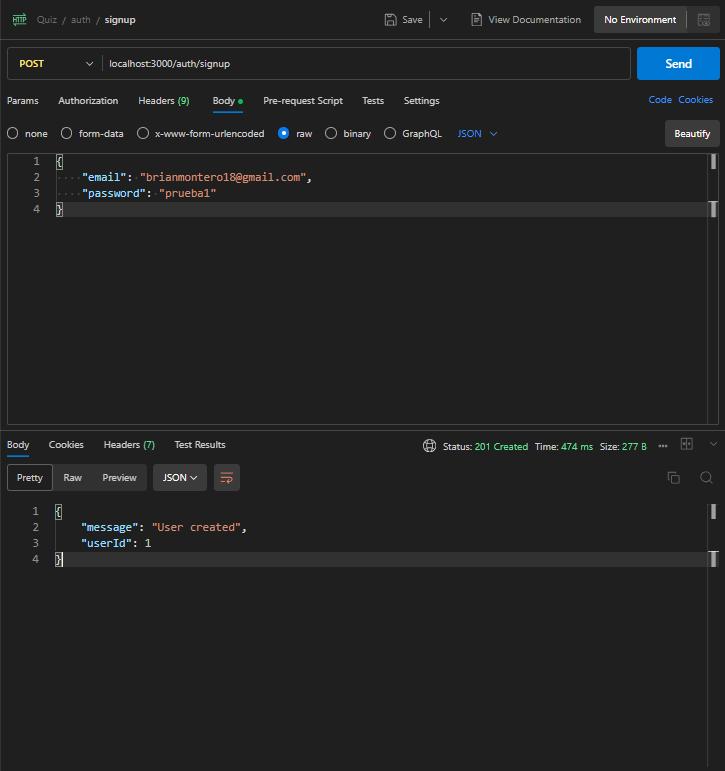
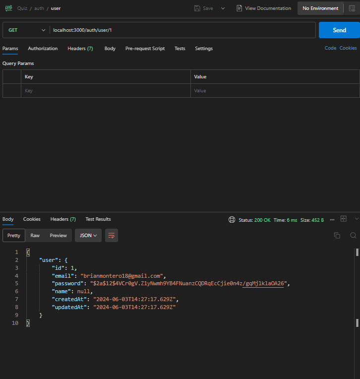
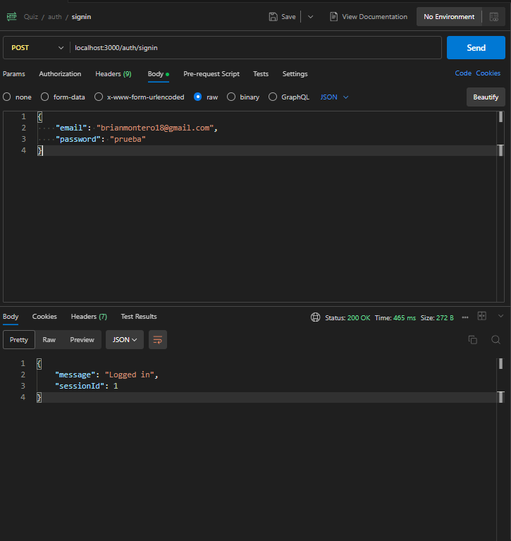
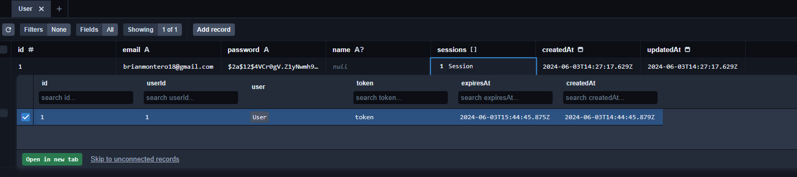
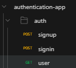

# Episodio 5: Gestión de Sesiones y Tokens

En este episodio, agregaremos una capa de seguridad relacionada a los tokens y asi garantizar que el intercambio entre cliente y servidor sea lo mas segura posible

## Prerequisitos

- Completar los episodios anteriores:
  - [Episodio 1: Introducción y Configuración](./1-ep-intro-y-config.md)
  - [Episodio 2: Configuración de Prisma y PostgreSQL](./2-ep-config-prisma-postgresql.md)
  - [Episodio 3: Definición de Modelos y Relaciones en Prisma](./3-ep-modelado-datos-prisma.md)
  - [Episodio 4: Creación de Endpoints de Autenticación](./4-ep-creacion-endpoints-auth.md)

### Conceptos Clave

- **JWT (JSON Web Tokens)**: es un estándar abierto (RFC 7519) que define una forma compacta y autónoma de transmitir información de forma segura entre las partes como un objeto JSON. Esta información puede ser verificada y confiable porque está firmada digitalmente.
- **Access Token**: es un tipo de token que se utiliza para acceder a los recursos protegidos de una API. Este token suele tener una vida útil corta (por ejemplo, 15 minutos) y se incluye en la cabecera de autorización en las solicitudes a la API.
- **Refresh Token**: es un tipo de token que se utiliza para obtener un nuevo Access Token sin necesidad de volver a autenticarse. Este token suele tener una vida útil más larga (por ejemplo, 7 días) y se almacena de forma segura en el cliente.
- **Cookie**: es un pequeño archivo que el servidor envía al navegador del usuario. Las cookies pueden ser utilizadas para almacenar información de sesión, preferencias del usuario y más.
- **HttpOnly Cookie**: es una cookie que no es accesible mediante JavaScript en el navegador, lo que ayuda a protegerla de ataques XSS (Cross-Site Scripting). Esta cookie es utilizada principalmente para almacenar tokens de autenticación de manera segura.
- **Autenticación**: proceso de verificar la identidad de un usuario.
- **Autorización**: proceso de verificar si un usuario tiene permiso para acceder a un recurso o realizar una acción específica.

## Pasos

### 1. Instalación de Dependencias

```bash
npm install jsonwebtoken
```

Instalar los types de jsonwebtoken

```bash
npm install @types/jsonwebtoken --save-dev
```

- La libreria `jsonwebtoken` nos permite crear, firmar y verificar tokens JWT, que utilizaremos para autenticar y autorizar usuarios en nuestra aplicación.

### 2. Configuración JWT y Tokens

Crea un archivo `src/utils/jwt.ts` para manejar la generación y verificación de tokens:

```typescript
import jwt from "jsonwebtoken";
import crypto from "crypto";
import prisma from "../config/prismaClient";

const ACCESS_TOKEN_SECRET = process.env.ACCESS_TOKEN_SECRET || "access-secret-key";

export const generateAccessToken = (userId: number) => {
  return jwt.sign({ userId }, ACCESS_TOKEN_SECRET, { expiresIn: "15m" });
};

export const generateRefreshToken = async (userId: number) => {
  const refreshToken = crypto.randomBytes(32).toString("hex");
  const expiresAt = new Date();
  expiresAt.setDate(expiresAt.getDate() + 7); // 7 días de expiración

  await prisma.refreshToken.create({
    data: {
      token: refreshToken,
      userId,
      expiresAt,
    },
  });
  return refreshToken;
};

export const verifyAccessToken = (token: string) => {
  return jwt.verify(token, ACCESS_TOKEN_SECRET);
};

export const verifyRefreshToken = async (token: string) => {
  const storedToken = await prisma.refreshToken.findUnique({
    where: { token },
  });

  if (!storedToken || storedToken.expiresAt < new Date()) {
    throw new Error("Invalid or expired refresh token");
  }

  return storedToken.userId;
};
```

### 3. Actualización Controladores de Autenticación

Actualiza `src/controllers/authController.ts` para manejar Access Tokens y Refresh Tokens:

```typescript
import { Request, Response } from "express";
import { validationResult } from "express-validator";
import bcrypt from "bcryptjs";
import { createUser, findUserByEmail, getUserById } from "../services/authService";
import { generateAccessToken, generateRefreshToken, verifyRefreshToken } from "../utils/jwt";
import { setAuthCookies } from "../utils/cookies";

export const postSignup = async (req: Request, res: Response) => {
  const errors = validationResult(req);
  if (!errors.isEmpty()) {
    return res.status(400).json({ errors: errors.array() });
  }

  const { email, password, name } = req.body;

  try {
    const user = await createUser(email, password, name);

    const accessToken = generateAccessToken(user.id);
    const refreshToken = await generateRefreshToken(user.id);

    setAuthCookies(res, accessToken, refreshToken);
    res.status(201).json({ message: "User created", user });
  } catch (error) {
    res.status(500).json({ message: "Something went wrong" });
  }
};

export const postSignin = async (req: Request, res: Response) => {
  const errors = validationResult(req);
  if (!errors.isEmpty()) {
    return res.status(400).json({ errors: errors.array() });
  }

  const { email, password } = req.body;

  try {
    const user = await findUserByEmail(email);
    if (!user) {
      return res.status(401).json({ message: "Invalid credentials" });
    }

    const isMatch = await bcrypt.compare(password, user.password);
    if (!isMatch) {
      return res.status(401).json({ message: "Invalid credentials" });
    }

    const accessToken = generateAccessToken(user.id);
    const refreshToken = await generateRefreshToken(user.id);

    setAuthCookies(res, accessToken, refreshToken);
    res.status(200).json({ message: "Logged in" });
  } catch (error) {
    res.status(500).json({ message: "Something went wrong" });
  }
};

export const getUser = async (req: Request, res: Response) => {
  const userIdString = req.params.userId;
  const userId = parseInt(userIdString, 10); // Convertir el string a número

  if (isNaN(userId)) {
    // Si el userId no es un número válido, responder con un error 400 (Bad Request)
    return res.status(400).json({ message: "Invalid userId" });
  }

  try {
    const user = await getUserById(userId);
    if (!user) {
      return res.status(404).json({ message: "User not found" });
    }

    res.status(200).json({ user });
  } catch (error) {
    res.status(500).json({ message: "Something went wrong" });
  }
};

export const refreshToken = async (req: Request, res: Response) => {
  const refreshToken = req.cookies.refreshToken;

  if (!refreshToken) {
    return res.status(401).json({ message: "Refresh token is required" });
  }

  try {
    const userId = await verifyRefreshToken(refreshToken);
    const accessToken = generateAccessToken(userId);

    setAuthCookies(res, accessToken, refreshToken);
    res.json({ accessToken });
  } catch (error) {
    res.status(401).json({ message: "Invalid refresh token" });
  }
};
```

### 4. Creación del Enrutador de Autenticación

Crear carpeta `src/routes`, y dentro de ella crea un archivo `authRoute.ts`:

```typescript
import { Router } from "express";
import { check } from "express-validator";
import { postSignup, postSignin, getUser, refreshToken } from "../controllers/authController";

const router = Router();

router.post("/signup", [check("email").isEmail(), check("password").isLength({ min: 6 })], postSignup);
router.post("/signin", [check("email").isEmail(), check("password").exists()], postSignin);
router.get("/user/:userId", getUser);
router.post("/refresh-token", refreshToken);

export default router;
```

### 5. Actualización de `app.ts`

Actualiza el archivo `src/app.ts` para usar las nuevas rutas:

```typescript
import express from "express";
import authRoutes from "./routes/authRoute";

const app = express();

// Middlewares
app.use(express.json());

// Routes
app.use("/auth", authRoutes);

export default app;
```

### 6. Probar los Endpoints

Instala Postman como extension en tu VSCode

- Prueba de POST `/auth/signup`

  

- Prueba de GET `/auth/user/:userId`

  

- Prueba de POST `/auth/signin`

  

- Chequea luego en Prisma Studio que el usuario tiene una sesion asociada

  

- Estructura de carpetas en Postman:

  

### 7. Estructura de Carpetas actualizada

```bash
server/
├── prisma/
│   ├── migrations/
│   │   │── 20240602173127_init/
│   │   │     │    └── migration.sql
│   │   │── 20240603134230_add_user_and_session_models/
│   │   │     │    └── migration.sql
│   │   └── migration_lock.toml
│   └── schema.prisma
├── src/
│   ├── config/
│   │   └── prismaClient.ts
│   ├── controllers/
│   │   └── authController.ts
│   ├── routes/
│   │   └── authRoute.ts
│   ├── services/
│   │   ├── authService.ts
│   ├── app.ts
│   └── server.ts
├── .env
├── .env.temp
├── tsconfig.json
└── .gitignore
```
